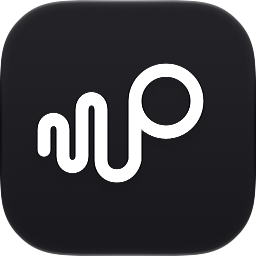
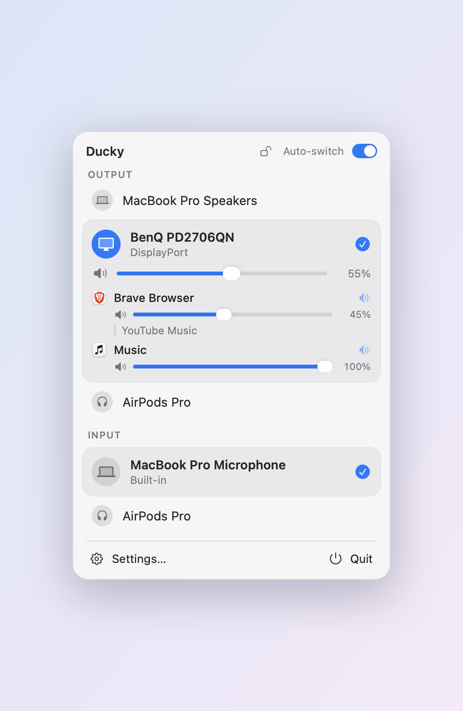
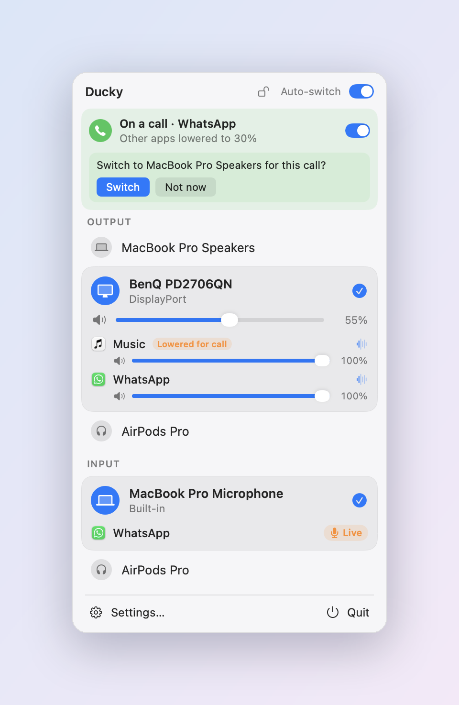

# Ducky: audio router and per-app volume control for Mac

**Ducky is a free macOS menu bar app that switches your audio output and microphone in one click, gives every app its own volume, and lowers music automatically when a call starts.**

Use it to move sound between your Mac's speakers, AirPods and other Bluetooth headphones, USB and aux devices, and external monitors; to turn one app down without touching the others; and to stop macOS jumping to the wrong microphone.

**[Download Ducky for Mac](https://github.com/ForeignerfromJupiter/ducky/releases/latest)** · free · macOS 15 or later · Apple Silicon and Intel

  <picture>
    <source media="(prefers-color-scheme: dark)" srcset="assets/screenshots/popover-everyday-dark.png">
    
  </picture>
  <picture>
    <source media="(prefers-color-scheme: dark)" srcset="assets/screenshots/popover-call-dark.png">
    
  </picture>

## Features

- **Switch audio output and input from the menu bar.** One click to move sound to your speakers, headphones, AirPods or monitor. The list updates as Bluetooth, USB and aux devices connect and disconnect.
- **Switch audio devices automatically.** Put your outputs and inputs in order once; when a device connects, or the one in use disconnects, Ducky picks the best one available, and undoes macOS jumping to a Bluetooth headset's microphone.
- **Per-app volume control.** When two or more apps share a device, each gets its own volume slider, like a volume mixer for Mac. Works with any app, including ones you install later.
- **Lower music during calls automatically (audio ducking).** As soon as any app uses the microphone (Zoom, Google Meet, Microsoft Teams, Slack, WhatsApp, FaceTime, Granola…), other apps fade to a level you choose, and come back when the call ends.
- **Move calls off your speakers.** If a call starts on a monitor or speaker, Ducky offers to move it to your Mac's own speakers, and switches back afterwards. Headphones are left alone.
- **See which app is playing where.** Each device lists the apps using it, and for Brave, Chrome, Edge and Arc, the browser tab that's playing or using the mic.
- **Control your monitor's volume.** For displays macOS can't control over DisplayPort or HDMI, Ducky sets the monitor's own volume over the display cable (DDC/CI).
- **Stay on these devices.** Lock your output and microphone; Ducky puts them back whenever macOS switches elsewhere.

## Install

1. Download `Ducky-<version>.zip` from [Releases](https://github.com/ForeignerfromJupiter/ducky/releases/latest) and unzip it.
2. Drag **Ducky** to your **Applications** folder and open it.

Ducky is signed with Developer ID and notarized by Apple, so it opens like any other app. It lives in the menu bar (no Dock icon) and tells you when a new version is out.

## Questions

**How do I change the volume of one app on a Mac?**
macOS only has one volume for everything. With Ducky, when two or more apps play on the same device, each gets its own slider in the menu bar, so you can keep a call at full volume and turn YouTube or Spotify down.

**How do I switch audio output on a Mac quickly?**
Click Ducky in the menu bar and pick a device. You can also set a preferred order so Ducky switches by itself when headphones or a speaker connect.

**How do I stop my Mac switching to the AirPods (or Bluetooth headset) microphone?**
Put your Mac's microphone first in Settings › Auto-switch, or lock your devices with the padlock. A Bluetooth headset's microphone forces the headset into a low-quality call mode, so keeping the Mac's mic also keeps your music sounding right.

**Can music get quieter automatically when I'm on a Zoom, Meet or Teams call?**
Yes. Ducky detects any app using the microphone, so it works with every calling app, including browser calls, and lowers the others to a level you choose.

**Why can't I change my monitor's volume on a Mac?**
Monitors connected over DisplayPort or HDMI usually have no volume control in macOS. Ducky adjusts the monitor's own volume over the display cable (DDC/CI) instead, so the slider works.

**Can I send different apps to different speakers?**
Not yet. Ducky shows which app is playing on which device and gives each its own volume; apps still play on the output macOS (or the app itself) chooses.

**Is Ducky free? Does it work on Apple Silicon and Intel?**
Yes, it's free, and it runs on both, on macOS 15 or later.

## Permissions

Ducky asks only when you use a feature that needs it:

| Permission | When | Why |
| --- | --- | --- |
| System Audio Recording | You first change an app's volume, or calls lower other apps | To pass that app's sound through Ducky at your level. Nothing is recorded or saved. |
| Accessibility | You click "Show which tab…" | To read the browser's tab names (read-only). |
| Notifications | The first time Ducky offers to move a call | To ask without taking over your screen. |

If Ducky quits, every app plays at full volume again immediately.

## Privacy

Everything happens on your Mac. Ducky has no account and no analytics. Its only network request is a daily check for a new version on GitHub, which sends nothing about you or your Mac and can be turned off in Settings › General.

## Known limits

- Two tabs in the same browser playing on the same device share one volume.
- macOS can't tell what's plugged into a monitor's headphone jack; name the monitor and pick an icon for it in Settings › Devices.
- Early release: expect rough edges. Feedback is welcome in [Issues](https://github.com/ForeignerfromJupiter/ducky/issues).
